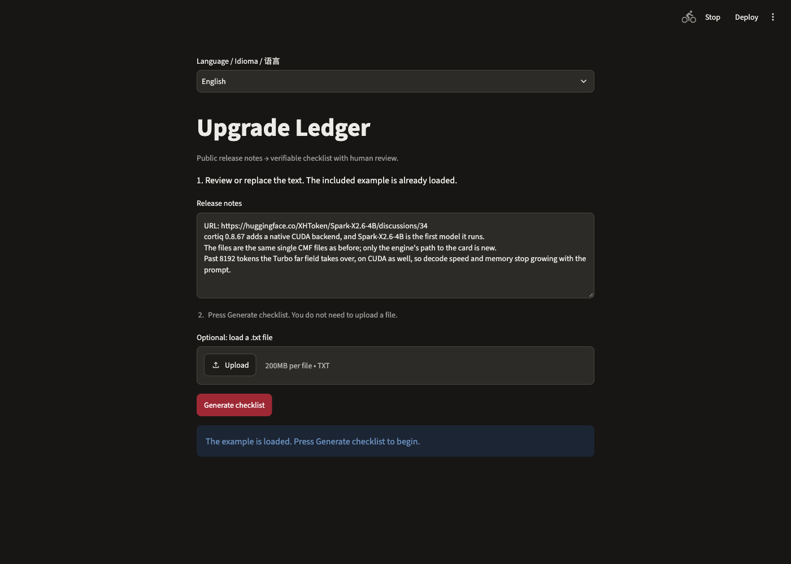
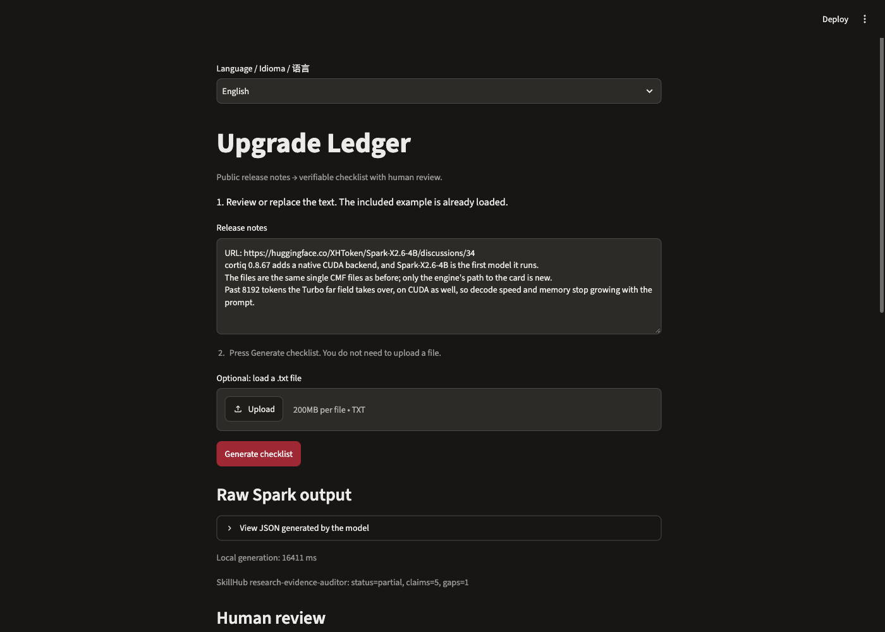
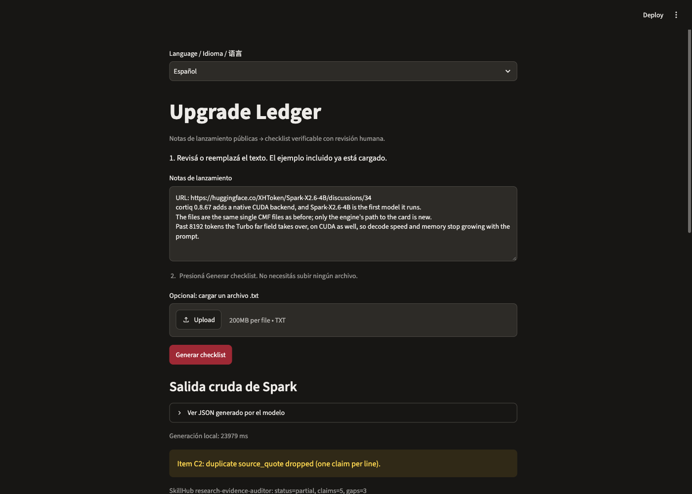
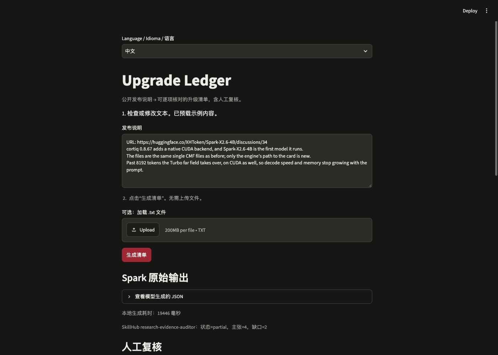

# [HER Hack-Astron #8] [Spark × SkillHub] Upgrade Ledger — verifiable upgrade checklist

## Project and track

Project name: Upgrade Ledger
Track: Developer tools (with a reusable pattern for Documents and extraction)

## User and task

Who uses the result, and what problem do they face?
A developer maintaining a local Spark deployment who must decide what changes after a release. Before this tool they read long release notes by hand, copy version numbers into a migration note and hope nothing was missed. They need to know which feature each change affects and whether it is breaking.

Sample input and acceptance criteria chosen before the run:
- Input: a short attributed excerpt of public release notes from `https://huggingface.co/XHToken/Spark-X2.6-4B/discussions/34`, stored as numbered lines in `data/release_notes.txt`.
- Acceptance criteria fixed before generation:
  1. Every checklist item must quote one source line verbatim.
  2. Every number in an item must exist in the source.
  3. A source line may produce at most one item.
  4. `breaking` must be true only when the source says so explicitly.
  5. A human can accept, correct or reject every item.

## SkillHub skill and Spark-X2.6-4B

Skill name, detail page, source and version:
`research-evidence-auditor`, https://skill.xfyun.cn/space/global/research-evidence-auditor , namespace `global`, published version `20260820.034025`. Installed with `npx @astron-team/skillhub@latest install research-evidence-auditor --namespace global --agent codex --scope project` (CLI 0.3.1). The installed package, including `scripts/audit_evidence.py` and the documented JSON contract, is committed under `.codex/skills/research-evidence-auditor/`.

Agent host and steps guided by the skill:
The entry was developed and driven by an AI coding agent (OpenCode) using the Codex skill profile. The skill guides claim splitting, source alignment, verdicts (`supported`/`refuted`/`contested`/`insufficient`) and the traceable report. The agent builds the skill's documented input JSON from the generated items and runs the skill's deterministic report builder.

Model source, revision and step performed by Spark:
`XHToken/Spark-X2.6-4B-GGUF`, file `Spark-X2.6-4B-Q4_K_M.gguf`, revision `fe31f8d64890302cc3a1d365d700357b4b75ba77`, served by llama-server at `http://localhost:8080/v1` as `spark2.6-4B`. Spark performs exactly one step: draft the strict JSON checklist from the numbered source lines. The agent does not send the release notes to any other model for generation.

Other models, tools or services and their roles:
None for inference. `requests` calls the fixed local endpoint. The skill's Python scripts are deterministic and local. No cloud API, no other LLM.

## Languages

The UI, the generation prompt and the human review controls are available in **English, Español and 中文**. Select the language at the top of the app, or use `run.py --lang en|es|zh`.

The model card declares `en` and `zh` only. Spanish is a transfer observation, not a declared capability, and is reported as such.

Evidence — one real local run per language, same source excerpt, Q4_K_M, no fabricated output:

| Language | Generation | Items | Skill claims | Gaps |
|---|---:|---:|---:|---:|
| English | 18,404 ms | 3 | 5 | 1 |
| Español | 19,989 ms | 3 | 5 | 3 |
| 中文 | 21,420 ms | 3 | 4 | 2 |

Artifacts: `evidence/run-en.json`, `evidence/run-es.json`, `evidence/run-zh.json`. `source_quote` stays verbatim English in all three languages because the quote must be an exact substring of the source; only `title` and `affects` are localized.

## Demo (required: video or illustrated walkthrough)

Video link or screenshots with captions: illustrated demo below (two consecutive screenshots of the real running app).



*Screenshot 1 — the app starts with the default public release-note excerpt. The "Upload" button opens the operating system's native file picker; a text area below lets reviewers paste release notes directly when a native file dialog is unavailable or inconvenient.*



*Screenshot 2 — English UI: real local generation (16,411 ms), raw Spark JSON expandable, skill audit summary, and accept / correct / reject controls with the exact source line under every item.*



*Screenshot 3 — Spanish UI (23,979 ms). A deterministic warning is visible: a duplicate source quote was dropped. The failure is shown, not hidden.*



*Screenshot 4 — Chinese UI (19,446 ms) with the same pipeline and a fully localized review surface.*

### Evidence: verbatim raw Spark output (run `run-03.json`, 21,578 ms)

```json
{"items":[{"id":"C1","title":"cortiq 0.8.67 añade un backend CUDA nativo y Spark-X2.6-4B es el primer modelo que ejecuta","affects":"cortiq 0.8.67","source_quote":"cortiq 0.8.67 adds a native CUDA backend, and Spark-X2.6-4B is the first model it runs.","breaking":false},{"id":"C2","title":"Los archivos son los mismos archivos CMF anteriores; solo el camino del motor a la tarjeta es nuevo","affects":"archivos CMF","source_quote":"The files are the same single CMF files as before; only the engine's path to the card is new.","breaking":false},{"id":"C3","title":"Más allá de 8192 tokens el campo lejano de Turbo toma el control, también en CUDA, por lo que la velocidad de decodificación y la memoria dejan de crecer con el prompt","affects":"Turbo far field","source_quote":"Past 8192 tokens the Turbo far field takes over, on CUDA as well, so decode speed and memory stop growing with the prompt.","breaking":false}]}
```

The same artifact, including the full skill report, is committed as `evidence/run-03.json` in the repository.

Actual input → raw Spark output → final artifact → human review:
- Input: `data/release_notes.txt` (3 attributed public lines).
- Raw Spark output: verbatim JSON stored in `outputs/run-03.json` under `raw_output`.
- Deterministic gates: exact schema, no invented numbers, exact quote grounding, negation guard, one claim per source line.
- Skill report: `status=partial`, 5 claims (2 supported, 3 insufficient), stored under `audit` in the same artifact.
- Human review: the Streamlit UI shows every item with accept / correct / reject and exports the final JSON.

## Reproduction

Installation and run steps:
```bash
python3 -m venv .venv && .venv/bin/pip install -r requirements.txt
.venv/bin/python -m unittest discover -s tests -v
.venv/bin/python run.py --output outputs/run.json
.venv/bin/python -m streamlit run app.py
```

Hardware, runtime version, precision or quantization, prompts and settings:
Mac, llama-server (llama.cpp), GGUF Q4_K_M, ctx 16384, `temperature=0.2`, `top_p=0.95`, `top_k=20`, `repeat_penalty=1.05`, `max_tokens=1200`, `chat_template_kwargs={"enable_thinking": false}`, single prompt in `src/prompts.py` (Spanish). Generation measured at 21,578 ms for the published run.

Code or runnable example: https://github.com/LucianoDPerez/spark-upgrade-ledger

## Results and limitations

Observed results, evaluation method and sample size:
21/21 unit tests pass without the model (structure, invented numbers, quote grounding, negation, duplicate quotes, cache, audit contract, language profiles). Three real local runs, one per language, each produced 3 items from 3 source lines; every quote is an exact substring of its numbered line; generation ranged 18.4–21.4 s. The skill reported 5 claims in en/es and 4 in zh, with `status=partial` in all three. This is a development check on one short excerpt, not a blind benchmark or a user study.

Failures, improvements and points requiring human review:
- First real run produced two items with the same source quote. A deterministic dedup gate now drops the duplicate and emits a visible warning. The warning appeared again in a later Spanish UI run (screenshot 3): it is a real recurring model failure, shown to reviewers rather than suppressed.
- The skill's claim splitter fragments Spanish text (`breaking=False)`), leaving 3 claims `insufficient` even though the exact-substring gate accepted the quotes. We report the disagreement instead of hiding it.
- `breaking` is checked for type only; its semantic correctness against the source is not proven by a deterministic gate and needs human review.
- The negation guard is keyword-based and will miss paraphrases.
- A developer must still confirm the final checklist against the original notes; the tool does not certify migration safety.

## Contributors and disclosure

Individual or team, profiles and actual contributions:
Luciano David Perez (https://github.com/LucianoDPerez) — design, implementation, tests, local runs and documentation.

How AI assisted development:
An AI coding agent assisted with scaffolding, prompt iteration and test generation. All model outputs quoted above are verbatim local runs; none were fabricated. The skill was installed and executed locally as described.

Data and dependency sources and permissions:
`data/release_notes.txt` contains short attributed excerpts of a public Hugging Face discussion, with the source URL recorded in the file. No personal data, tokens or credentials are included.
