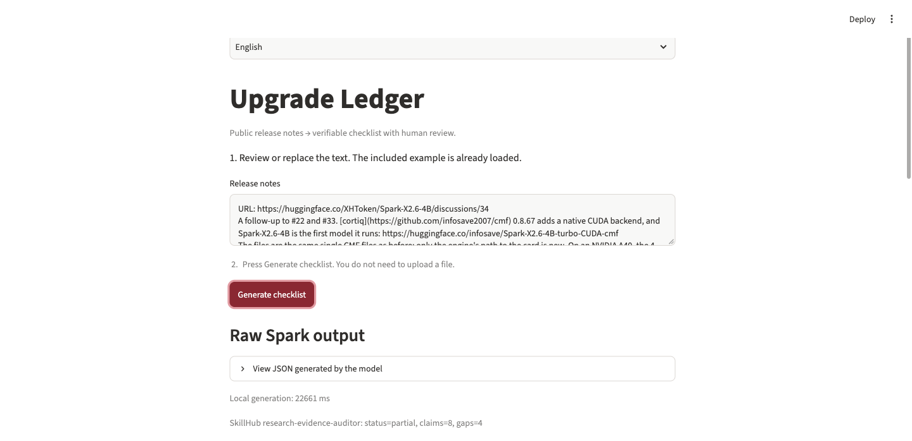
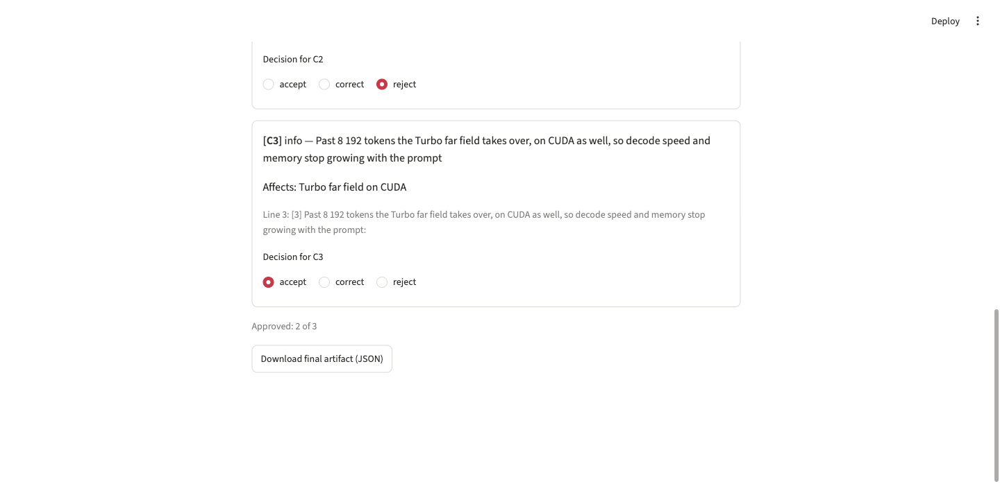
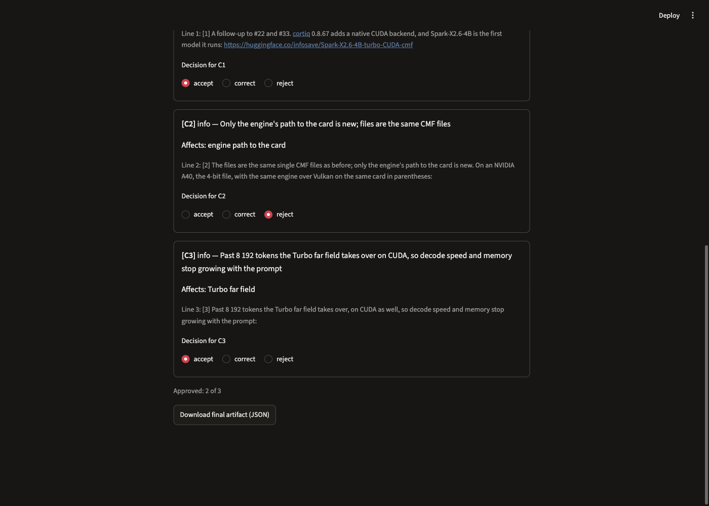

# [HER Hack-Astron #8] [Spark × SkillHub] Upgrade Ledger — verifiable upgrade checklist

## Project and track

Project name: Upgrade Ledger
Track: Developer tools

## Why this matters (30-second version)

1. **Problem:** a developer updating a local model has to read a long release-note style post and decide what actually changed. Missing a breaking change costs hours.
2. **Why Spark is needed:** one identifiable step — turning the source into a structured checklist — runs fully local. No cloud call, no other model for generation.
3. **What SkillHub adds that Spark cannot guarantee:** an independent claim-by-claim audit against the **whole** source. The model never audits its own output; the skill does.
4. **Traceability:** every item carries an exact numbered source line; the deterministic gates reject cross-line quotes and invented numbers; the artifact preserves the generated text and the human correction separately.
5. **Why a human still decides:** each item starts as `pending` — the counter reads `Approved: 0 of 3` right after generation. A person must explicitly accept, enter a non-empty correction, or reject. Screenshots 3 and 4 show real explicit decisions ending at `Approved: 2 of 3`. The system is not designed to auto-approve anything the model emits.

## User and task

Who uses the result, and what problem do they face?
A developer maintaining a local Spark deployment who must decide what changed after an update. Before this tool they read long release-note style posts by hand, copy version numbers into a migration note and hope nothing was missed. They need to know which feature each change affects and whether it is breaking.

Sample input and acceptance criteria chosen before the run:
- Input: three numbered lines copied **verbatim** from the public model-hub discussion https://huggingface.co/XHToken/Spark-X2.6-4B/discussions/34, stored in `data/release_notes.txt`. This is a community discussion about the cortiq runtime, **not** an official Spark release note; the distinction is deliberate and reported here.
- Acceptance criteria fixed before generation:
  1. Every checklist item must quote one source line verbatim (`8 192` with its space, trailing colon and URL included).
  2. Every number in an item must exist in the source.
  3. A source line may produce at most one item.
  4. `breaking` must be true only when the source says so explicitly.
  5. A human can accept, correct or reject every item.

## SkillHub skill and Spark-X2.6-4B

Skill name, detail page, source and version:
`research-evidence-auditor`, https://skill.xfyun.cn/space/global/research-evidence-auditor , namespace `global`, published version `20260820.034025`. Installed with `npx @astron-team/skillhub@latest install research-evidence-auditor --namespace global --agent codex --scope project` (SkillHub CLI 0.3.1). The installed package is committed under `.codex/skills/research-evidence-auditor/`. Verified with `diff -r` against a fresh install from the registry: all 22 content files are byte-identical; only `.skillhub/metadata.json` differs in `agent` (`codex` vs `custom`) and `installedAt`.

Agent host and steps guided by the skill:
The entry was developed and driven by an AI coding agent (OpenCode) using the Codex skill profile. The skill guides claim splitting, source alignment, verdicts (`supported`/`refuted`/`contested`/`insufficient`) and the traceable report. The agent builds the skill's documented input JSON and runs its deterministic report builder.

The audit is deliberately **independent**: `build_payload()` sends **every numbered source line** to the auditor as a separate evidence chunk. The model's selected `source_quote` is never used as the auditor's evidence. This avoids the circularity of asking the auditor to verify the model against quotes the model itself picked.

Model source, revision and step performed by Spark:
`XHToken/Spark-X2.6-4B-GGUF`, file `Spark-X2.6-4B-Q4_K_M.gguf`, revision `fe31f8d64890302cc3a1d365d700357b4b75ba77`, file SHA256 `91cb2811aebb47ac916aa619d27d4cdd7f4143106b7917accb8ead4cd7f5cbd9`, served by llama-server at `http://localhost:8080/v1` as `spark2.6-4B`. Spark performs exactly one step: draft the strict JSON checklist from the numbered source lines. No other model is used for generation.

Other models, tools or services and their roles:
None for inference. `requests` calls the fixed local endpoint. The skill's Python pipeline is deterministic and local. No cloud API.

## Languages

The UI, generation prompt and review controls are available in **English, Español and 中文**. Select the language at the top of the app, or use `run.py --lang en|es|zh`.

The model card declares `en` and `zh` only. Spanish is a transfer observation, not a declared capability, and is reported as such.

Evidence — one real local run per language on the same verbatim source, Q4_K_M, no fabricated output:

| Language | Generation | Items | Skill claims | Gaps |
|---|---:|---:|---:|---:|
| English | 21,669 ms | 3 | 8 | 4 |
| Español | 24,958 ms | 3 | 8 | 6 |
| 中文 | 23,960 ms | 3 | 7 | 5 |

Artifacts: `evidence/run-en.json`, `evidence/run-es.json`, `evidence/run-zh.json`. `source_quote` stays verbatim English in all three languages because the validator requires an exact substring of the source; only `title` and `affects` are localized.

## Demo (required: video or illustrated walkthrough)

Illustrated walkthrough — four consecutive screenshots of **one single English run** (generation 22,751 ms). The example is preloaded and there is no file uploader at all, so the only action is the Generate button, visible without scrolling. A reviewer can replace the text by pasting into the text box; no native file dialog is involved.


*Screenshot 1 — input with the verbatim three-line excerpt and the Generate button visible in the first viewport. There is no Upload control.*



*Screenshot 2 — `Local generation: 22751 ms`, SkillHub audit `status=partial, claims=8, gaps=4`, raw Spark JSON expandable, and the human review section below.*



*Screenshot 3 — the same run before any decision: all three radios unselected, `Approved: 0 of 3`, and both export buttons. Nothing is approved implicitly.*



*Screenshot 4 — the same run after explicit decisions: C2 marked `reject`, C3 marked `accept` (C1 was accepted above the fold), `Approved: 2 of 3`, and both export buttons. `evidence/ui-final-artifact.json` contains only the two approved items; `evidence/ui-review-log.json` contains all three items with their original text, decision, correction and approval flag, including the rejected C2.*

### Verbatim raw Spark output from that run

```json
{"items":[{"id":"C1","title":"Adds a native CUDA backend and first model Spark-X2.6-4B","affects":"Spark-X2.6-4B","source_quote":"[1] A follow-up to #22 and #33. [cortiq](https://github.com/infosave2007/cmf) 0.8.67 adds a native CUDA backend, and Spark-X2.6-4B is the first model it runs: https://huggingface.co/infosave/Spark-X2.6-4B-turbo-CUDA-cmf","breaking":false},{"id":"C2","title":"Only the engine's path to the card is new; files are the same single CMF files","affects":"engine path to the card","source_quote":"[2] The files are the same single CMF files as before; only the engine's path to the card is new. On an NVIDIA A40, the 4-bit file, with the same engine over Vulkan on the same card in parentheses:","breaking":false},{"id":"C3","title":"Past 8 192 tokens the Turbo far field takes over on CUDA, so decode speed and memory stop growing with the prompt","affects":"Turbo far field on CUDA","source_quote":"[3] Past 8 192 tokens the Turbo far field takes over, on CUDA as well, so decode speed and memory stop growing with the prompt:","breaking":false}]}
```

Also committed as `evidence/ui-raw-output.json`. The exported artifact from the human rejection is `evidence/ui-final-artifact.json`, and the full skill audit report for the same source is in `evidence/run-en.json`.

Input → raw output → review → artifact:
- Input: `data/release_notes.txt` (3 verbatim public lines, URL recorded in the file).
- Raw output: above, verbatim.
- Gates: exact schema, no invented numbers, exact quote grounding (the `[N]` prompt prefix is stripped deterministically), negation heuristic, one claim per source line.
- Audit: full source supplied as evidence; `status=partial`.
- Human review: one rejection performed and exported, as shown in screenshot 4.

## Reproduction

```bash
python3 -m venv .venv && .venv/bin/pip install -r requirements.txt
.venv/bin/python -m unittest discover -s tests -v
.venv/bin/python run.py --lang en --output outputs/run.json
.venv/bin/python -m streamlit run app.py
```

Hardware/runtime/precision/settings:
GGUF Q4_K_M, SHA256 `91cb2811aebb47ac916aa619d27d4cdd7f4143106b7917accb8ead4cd7f5cbd9`, ctx 16384;

```text
$ sw_vers
ProductName:		macOS
ProductVersion:		15.5
BuildVersion:		24F74

$ sysctl -n machdep.cpu.brand_string
Apple M1
$ sysctl -n hw.memsize
17179869184          # 16 GB

$ llama-server --version
version: 0.9.0 (build 12110, commit cd959bae9)
built with AppleClang 17.0.0.17000604 for Darwin arm64
```

The matching Q4_K_M blob (3,543,441,312 bytes, cached locally on 2026-10-21) was already present in the HF cache, so no weights were fetched during the recorded runs.

Inference settings: `temperature=0.2`, `top_p=0.95`, `top_k=20`, `repeat_penalty=1.05`, `max_tokens=1200`, `chat_template_kwargs={"enable_thinking": false}`. Prompts: `src/prompts.py` + `src/languages.py`.

Code: https://github.com/LucianoDPerez/spark-upgrade-ledger

## Results and limitations

Observed results, method and sample size:
31/31 unit tests pass without the model, including explicit-approval cases (no review, pending, empty correction, accept, reject) and the separation between the final checklist and the full review log. Three real local runs (one per language) each produced 3 items from 3 source lines; every quote is grounded in exactly one numbered line; generation 21.7–25.0 s. The validator rejects cross-line quotes and allows at most one item per source line. The auditor receives no artificial `score=1.0`; the skill's neutral default applies. A `correct` decision with empty text cannot be approved or exported. One UI run produced the four screenshots above and an exported artifact with one human rejection. The auditor received all source lines and still returned `status=partial` in every run. This is a development check on one short excerpt, not a blind benchmark or a user study.

Failures, improvements, human review:
- An early run emitted two items with the same source quote; a deterministic dedup gate now drops the duplicate and shows a visible warning.
- The skill's claim splitter fragments Spanish text (`breaking=False)`), leaving several claims `insufficient` even when the exact-substring gate accepted the quote. Reported, not hidden.
- `breaking` is type-checked only; its semantic correctness needs human review.
- The negation guard is keyword-based and misses paraphrases.
- `source_quote` is the whole numbered source line (exact substring after stripping the `[N]` prefix). That makes grounding a check against a full line, not against a short fragment of the changed fact; a shorter evidence span would be a stronger check and is future work.
- The excerpt is a community discussion, not an official release note; a real migration would need a longer, authoritative source.
- A developer must confirm the final checklist against the original notes; this tool does not certify migration safety.

## Contributors and disclosure

Individual: Luciano David Perez — GitHub https://github.com/LucianoDPerez , Hugging Face https://huggingface.co/bsoft2005Personal .

Precise contribution statement:
The human participant defined the task, chose the track and input, set the acceptance criteria, reviewed every model output shown here, performed the rejection in screenshot 4, and published the entry. An AI coding agent (OpenCode) wrote the scaffolding, prompts, tests and documentation under the participant's direction, and ran the SkillHub CLI and the local model. No AI tool is listed as a participant.

How AI assisted development:
An AI coding agent assisted with scaffolding, prompt iteration, test generation and the illustrated walkthrough. All model outputs quoted above are verbatim local runs; none were fabricated. The skill was installed and executed locally as described.

Data and dependency sources:
`data/release_notes.txt` contains three verbatim lines from a public Hugging Face discussion with the URL recorded in the file. No personal data, tokens or credentials are included.
